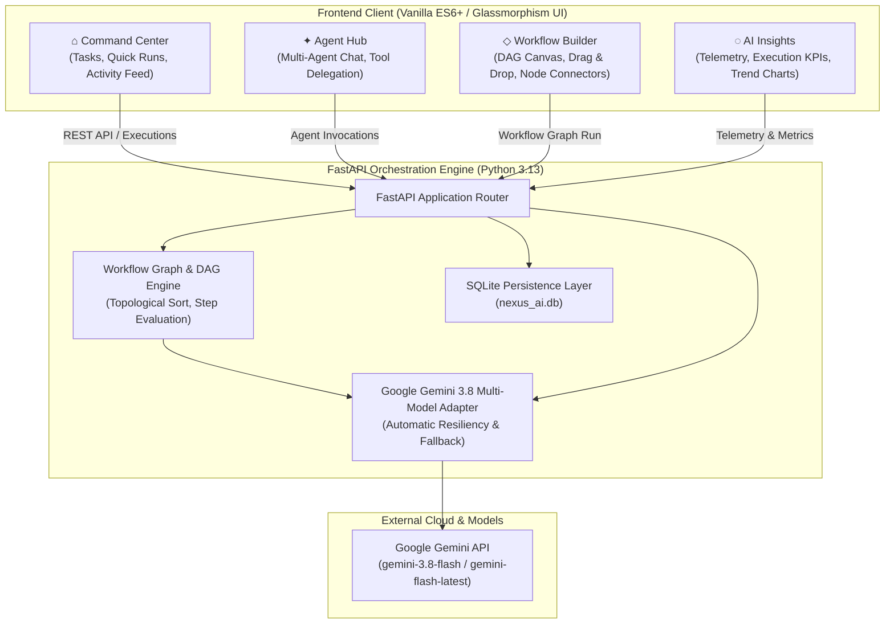

# NEXUS AI — Intelligent Work Studio

[](https://fastapi.tiangolo.com)
[](https://ai.google.dev)
[](https://www.sqlite.org)
[](https://developer.mozilla.org/en-US/docs/Web/JavaScript)
[](LICENSE)

> **NEXUS AI** is a production-ready, dark-mode/glassmorphic Intelligent Work Studio uniting autonomous AI Agents, visual Workflow Orchestration, Workspace Command & Telemetry, and Real-Time AI Insights powered by FastAPI, SQLite, and Google Gemini.

---

## 🏛 System Architecture



---

## 🌟 The 4 Core Modules

### 1. ⌂ Command Center (`/command-center`)
- **Central Workspace Hub:** Unifies task management, project focus domains, live notifications, and real-time execution activity stream.
- **Direct Live Execution:** Trigger real Google Gemini runs directly from agent cards and automated workflow pipelines with interactive execution result dialogs.
- **Live SQLite Sync:** Automatically synchronizes and displays recent execution logs, timestamps, and durations.
- **Quick Command Palette (`⌘K` / `Ctrl+K`):** Instantly navigate the studio, launch agents, search actions, and manage workflows.

### 2. ✦ Agent Hub (`/agent-hub`)
- **Specialized AI Agents:**
  - **Deep Research Agent:** Performs structured synthesis, factual literature reviews, and research summaries.
  - **Data Analyst Agent:** Evaluates metrics, conducts latency tail audits, and produces statistical performance breakdowns.
  - **Task Automation Agent:** Deconstructs complex requests into phased execution plans with milestones, checklists, and dependency tracking.
- **Interactive Multi-Agent Chat:** Real-time conversational interface connected to the FastAPI backend and Google Gemini.
- **Agent Metrics & Status:** Live status tracking, execution count counters, and latency monitoring.

### 3. ◇ Workflow Builder (`/workflow-builder`)
- **Visual Node Canvas:** Add, configure, connect, and customize modular automation building blocks:
  - `⚡ Trigger`: Inbound events, webhooks, or scheduled jobs.
  - `🤖 AI Agent`: High-reasoning inference steps powered by Gemini.
  - `🔧 Tool`: External API invocations, ERP ticket creation, calculations, and data processing.
  - `🔀 Condition`: Logical branching, threshold evaluation, and conditional path routing.
  - `📤 Output`: Final formatted deliverables, emails, or status reports.
- **Topological Graph Sorting:** Resolves node execution order from entry triggers to terminal outputs.
- **Execution Stability & Persistence:** Workflows and AI execution reports never vanish on reload; state is cached locally and results are permanently stored in SQLite.

### 4. ◌ AI Insights (`/ai-insights`)
- **Real-Time Telemetry:** Connects directly to backend SQLite execution logs (`/api/executions` and `/api/executions/metrics/summary`).
- **Dynamic KPIs:** Real execution volume, overall success rate %, active agent counts, and average runtime latency.
- **Interactive SVG Charts:** Daily volume throughput trends and per-agent runtime distribution charts.
- **Agent Performance Audit:** Detailed table tracking runs, reliability percentages, and specialty areas.
- **Live Activity Feed:** Granular log of recent executions with execution status badges, relative time, and duration.

---

## 🛠 Tech Stack

| Layer | Technology | Description |
|---|---|---|
| **Frontend** | HTML5, CSS3, Vanilla ES6+ | Glassmorphism dark UI, CSS variables, responsive grid, zero external JS dependencies |
| **Backend** | Python 3.12/3.13, FastAPI | Asynchronous RESTful API, CORS middleware, strict validation |
| **LLM Provider** | Google GenAI SDK | Gemini 3.8 Flash with multi-model fallback resiliency (`gemini-flash-latest`, `gemini-2.5-flash-lite`) |
| **Database** | SQLite 3 (`nexus_ai.db`) | Persistent logging of execution IDs, prompts, responses, durations, and statuses |
| **Server** | Uvicorn | High-performance ASGI web server |

---

## 🚀 Quickstart & Installation

### 1. Clone the Repository
```bash
git clone https://github.com/naveed810/NEXUS-AI.git
cd NEXUS-AI
```

### 2. Set Up Python Virtual Environment
```bash
# Windows
python -m venv venv
.\venv\Scripts\activate

# macOS / Linux
python3 -m venv venv
source venv/bin/activate
```

### 3. Install Backend Dependencies
```bash
pip install -r backend/requirements.txt
```

### 4. Configure Environment Variables
Create a file at `backend/.env`:
```env
GEMINI_API_KEY=your_google_gemini_api_key_here
```
> Obtain your Gemini API key from [Google AI Studio](https://aistudio.google.com/app/apikey).

### 5. Launch the FastAPI Backend
```bash
cd backend
python -m uvicorn app.main:app --port 8000 --reload
```
FastAPI will be available at:
- **API Server:** `http://127.0.0.1:8000`
- **Interactive OpenAPI Docs (Swagger):** `http://127.0.0.1:8000/docs`
- **Health Check:** `http://127.0.0.1:8000/api/health`

### 6. Launch the Frontend
You can open any module using VS Code **Live Server** or any static file server:
- **Command Center:** Open `command-center/index.html`
- **Agent Hub:** Open `agent-hub/index.html`
- **Workflow Builder:** Open `workflow-builder/index.html`
- **AI Insights:** Open `ai-insights/index.html`

---

## 📡 REST API Reference

| Method | Endpoint | Description |
|---|---|---|
| `GET` | `/api/health` | Service health, Gemini LLM connection, and SQLite status |
| `GET` | `/api/system/status` | System telemetry, uptime, agent count, execution stats |
| `GET` | `/api/agents` | List all available registered AI agents |
| `GET` | `/api/agents/{agent_id}` | Retrieve details for a specific agent |
| `POST` | `/api/agents/{agent_id}/run` | Execute an AI agent with a custom user goal |
| `GET` | `/api/agents/{agent_id}/metrics` | Retrieve run counts, success rate, and average latency |
| `GET` | `/api/workflows` | List pre-configured workflows |
| `POST` | `/api/workflows/{workflow_id}/run` | Execute a complete multi-step node workflow DAG |
| `GET` | `/api/executions` | Retrieve recent execution records from SQLite database |
| `GET` | `/api/executions/{execution_id}` | Retrieve full details of an individual execution run |
| `GET` | `/api/executions/metrics/summary` | Aggregate metrics (total runs, success rate, mean latency) |

---

## 👥 GitHub Collaborative Workflow & Team Roles

This project was built following industry-standard Git flow practices:
- **Protected `main` branch:** Direct commits blocked; all code merged via Pull Requests.
- **Feature Branches:**
  - `feature/command-center`: Command Center UI, onboarding, task management, activity feed.
  - `feature/agent-hub`: Agent Hub interface, conversational streaming, prompt engineering.
  - `feature/workflow-builder`: Drag-and-drop workflow canvas, node connections, execution reporting.
  - `member4-ai-insights`: Telemetry dashboard, interactive SVG charts, agent reliability analysis.
- **Code Reviews & PR Approvals:** Peer-reviewed PRs #1, #2, #3, and #4 merged into `main`.

---

## 🏆 Hackathon Demonstration Flow

To demonstrate the full end-to-end studio in 3 minutes:
1. **Command Center:** Showcase the personal workspace, view tasks, and click **▶ Run** on an agent to show Gemini generating a live response inside an interactive modal.
2. **Agent Hub:** Navigate to Agent Hub, trigger **Deep Research Agent**, and watch real Gemini research synthesis generated in real time.
3. **Workflow Builder:** Open Workflow Builder, load the **Sample Customer Support Workflow**, add or edit a Condition node, click **▶ Run Workflow**, and inspect the comprehensive **Workflow Execution Report** with graph resolution trace and node metrics.
4. **AI Insights:** Open AI Insights, click **↻ Refresh**, and show the live SQLite synchronization reflecting the newly executed workflow with updated KPIs, charts, and activity logs.

---

## 📄 License
This project is licensed under the MIT License — see the [LICENSE](LICENSE) file for details.
